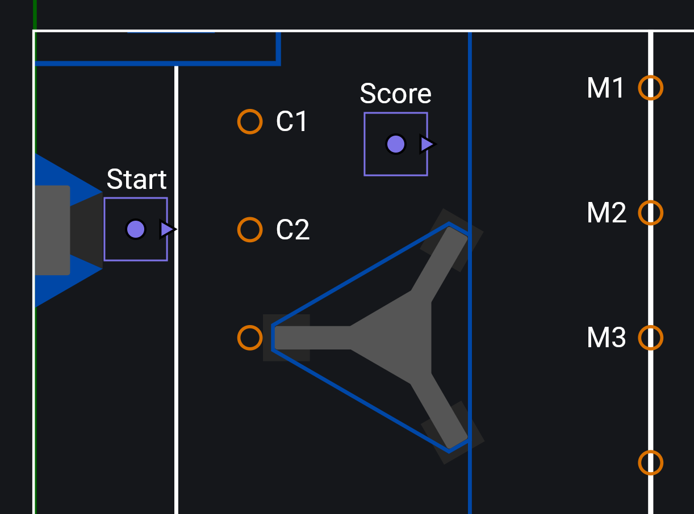

# AutoFactory (Java Only, Commands v3)

!!! note
    This API is only available for Java, and only for WPILib's Commands v3. If your robot uses Commands v2, see [AutoFactory (Commands v2)](auto-factory-cmd2.md). C++ and Python users should use the [Trajectory API](./trajectory-api.md).

    Commands v3 support has its own vendordep, which can't be installed alongside the Commands v2 one. See [Getting Started](./getting-started.md#installing-choreolib).

ChoreoLib provides the `AutoFactory` ([Java](/api/choreolib/java-commands3/choreo/commands3/AutoFactory.html)) class for building autos in your robot code. Its classes live in the `choreo.commands3` package.

```java title="Robot.java"
public class Robot extends OpModeRobot {
    private final Drive drive = new Drive(); // implements Mechanism
    private final AutoFactory autoFactory;

    public Robot() {
        autoFactory = new AutoFactory(
            drive::getPose, // A function that returns the current robot pose
            drive::resetOdometry, // A function that resets the current robot pose to the provided Pose2d
            drive::followTrajectory, // The drive trajectory follower (1)
            true, // If alliance flipping should be enabled (2)
            drive // The drive Mechanism
        );
    }

    @Override
    public void robotPeriodic() {
        Scheduler.getDefault().run(); // (3)
    }
}
```

1. See [Getting Started](./getting-started.md/#setting-up-the-drive-subsystem) for how to implement a trajectory follower in your drive. In Commands v3 the drive is a `Mechanism`, not a `Subsystem`.
2. Create trajectories only on the blue side of the field in the Choreo application. With alliance flipping on, they mirror to the red side when the robot is on the red alliance.
3. The scheduler runs commands and polls triggers, so call it every loop.

!!! tip
    Create the `AutoFactory` in the `Robot` constructor, not in the drive. Some teams put it in a separate class such as `Autos.java` that takes the robot's mechanisms and builds every auto.

## Autos are Opmodes

With Commands v3 there is no auto chooser. Each autonomous routine is an autonomous opmode, and your drive team selects it on the Driver Station like any other opmode. Commands v3 scopes an opmode's commands and trigger bindings to that opmode, so they all end when it does.

There are two ways to create autos with an `AutoFactory`: [coroutines](#using-coroutines) or the [`AutoRoutine`](#using-autoroutine) class. Use a coroutine for short autos that run from start to finish. It reads top to bottom like ordinary code. Use `AutoRoutine` when an auto has many segments, mechanisms that react to each other, or branches.

!!! note
    The following examples use "segmented" trajectories: several small, reusable trajectories combined into one autonomous sequence. You may be used to "monolithic" trajectories, a single trajectory that spans the whole autonomous period from start to finish without stopping.

    Monolithic trajectories can be more cumbersome, especially for branching autos, and it is harder to inject logic between points of interest along one.

    If you don't plan on branching autos, you can still get segmented behavior from a monolithic trajectory with the "Split" checkbox on a waypoint in the Choreo application. Overloads of the trajectory methods take the index of a split to fetch that segment.

## Using Coroutines

A Commands v3 command body is ordinary Java code. It can pause, wait for other commands, and carry on afterwards, so you don't need to nest `Command.sequence()`, `Command.parallel()` and `Command.race()`. The body receives a `Coroutine` with four methods for running other commands:

| Method | What it does |
|---|---|
| `fork(commands...)` | Starts the commands and returns immediately. They keep running until they finish, the parent command ends, or the parent cancels them. |
| `await(command)` | Runs one command and waits until it finishes. |
| `awaitAll(commands...)` | Runs the commands at the same time and waits until all of them finish. |
| `awaitAny(commands...)` | Runs the commands at the same time and waits until any of them finishes, then cancels the rest. |

`AutoFactory.trajectoryCmd()` creates a command that follows a trajectory.

```java
// Follows deploy/choreo/myTrajectory.traj
Command myTrajectory = autoFactory.trajectoryCmd("myTrajectory");
```

!!! warning
    Trajectories are sampled using a timer, which also decides when the command ends. Your robot isn't guaranteed to finish exactly at the end of a trajectory. Tuning your drivetrain and the feedback gains in your trajectory follower reduces this error.

Combine trajectory commands with the rest of your robot inside a command that requires no mechanisms itself. Each command it runs requires what it needs.

```java
public Command pickupAndScoreAuto() {
    return Command.noRequirements(co -> {
        // (1)
        co.await(autoFactory.resetOdometry("pickupGamepiece"));

        // Drive to the gamepiece while intaking, and stop the intake when we get there (2)
        co.awaitAny(autoFactory.trajectoryCmd("pickupGamepiece"), intake.intake());

        // Drive to the scoring position while getting ready, and wait for both to finish
        co.awaitAll(autoFactory.trajectoryCmd("scoreGamepiece"), scoring.getReady());

        co.await(scoring.score());
    }).named("Pickup And Score");
}
```

1. Always reset your robot's odometry to the start of the first trajectory in an autonomous routine. `AutoFactory.resetOdometry()` sets the robot's pose to the start of the specified trajectory.

    Advanced users may use vision to get the robot's starting position, but this isn't recommended for most teams.

2. `awaitAny()` returns when the first command finishes and cancels the others. The trajectory ends on its own and `intake.intake()` doesn't, so the intake stops when the trajectory is done. These examples assume mechanisms expose command factory methods, so `intake.intake()` returns a `Command`.

The body is plain Java, so `if`, loops and local variables work between steps. Branching is just an `if`:

```java
public Command scoreIfWeHaveOneAuto() {
    return Command.noRequirements(co -> {
        co.await(autoFactory.resetOdometry("startToMidline"));
        co.await(autoFactory.trajectoryCmd("startToMidline"));

        if (shooter.hasGamepiece()) {
            co.await(autoFactory.trajectoryCmd("midlineToScore"));
            co.await(shooter.shoot());
        } else {
            co.await(autoFactory.trajectoryCmd("midlineToNextGamepiece"));
        }
    }).named("Score If We Have One");
}
```

Use `fork()` to run something in the background. A forked command is cancelled when the command that forked it ends:

```java
public Command intakeWhileDrivingAuto() {
    return Command.noRequirements(co -> {
        co.fork(intake.intake()); // keeps running while we drive, stops when this command ends
        co.await(autoFactory.trajectoryCmd("firstSegment"));
        co.await(autoFactory.trajectoryCmd("secondSegment"));
    }).named("Intake While Driving");
}
```

!!! note
    `Command.sequence()`, `Command.parallel()` and `Command.race()` still work with ChoreoLib's commands. Coroutines are usually shorter, and a plain `if` handles branching.

To run a coroutine as an autonomous opmode, register an opmode that schedules it in `start()`. The opmode is created when it's selected on the Driver Station, so the command is scoped to it and cancelled when it ends:

```java
// In the Robot constructor
addOpMode(RobotMode.AUTONOMOUS, "Pickup And Score", () -> new OpMode() {
    @Override
    public void start() {
        Scheduler.getDefault().schedule(pickupAndScoreAuto());
    }
});

publishOpModes(); // (1)
```

1. Registering an opmode doesn't show it on the Driver Station. Call `OpModeRobot.publishOpModes()` after registering your opmodes. See [Publishing Opmodes](#publishing-opmodes).

## Using AutoRoutine

A coroutine is the simplest way to write an auto that runs from start to finish. It gets unwieldy with many branches, with mechanisms that use default commands, or when mechanisms should run independently and hand off actions to each other. `AutoRoutine` ([Java](/api/choreolib/java-commands3/choreo/commands3/AutoRoutine.html)) handles those cases. It uses Commands v3 `Trigger`s to react to state, and doesn't require mechanisms until they're needed.

An `AutoRoutine` is an opmode. Register one with `AutoFactory.addRoutine()`, passing the robot, the name shown on the Driver Station, and a function that sets up the routine:

```java
// Registers an autonomous opmode named "Example Routine"
autoFactory.addRoutine(this, "Example Routine", routine -> {
    routine.active().onTrue(Command.noRequirements(co -> System.out.println("Started the routine!")).named("Print"));
});
```

### Publishing Opmodes

!!! warning
    Registering a routine with `addRoutine()`, or any opmode with `OpModeRobot.addOpMode()`, doesn't make it appear on the Driver Station. Call `OpModeRobot.publishOpModes()` after registering all your opmodes, or your drive team won't see them in the opmode list.

```java title="Robot.java"
public Robot() {
    autoFactory = new AutoFactory(/* ... */);

    autoFactory.addRoutine(this, "Example Routine", this::exampleRoutine);
    autoFactory.addRoutine(this, "Other Routine", this::otherRoutine);

    publishOpModes(); // Publish everything registered above to the Driver Station
}
```

Call it again after adding or removing opmodes later, to send the updated list. `OpModeRobot` publishes `@Autonomous` classes itself when it's constructed (see [Routines as Classes](#routines-as-classes)), so those don't need the call. Anything you register yourself does.

### How Routines Are Built

The function you give `addRoutine()` doesn't run right away. It runs each time the opmode is selected on the Driver Station, on a new `AutoRoutine`, so every trigger and command it creates is scoped to that opmode. `addRoutine()` returns nothing on purpose. A routine built ahead of time, such as in the `Robot` constructor, wouldn't be scoped to the opmode, and its triggers would stay alive for the whole match.

Every routine starts from the `AutoRoutine.active()` trigger. It's true from when the opmode starts until it ends or the robot is disabled. Bind the first command you want to run to it.

`AutoRoutine.trajectory()` loads a trajectory and returns an `AutoTrajectory` ([Java](/api/choreolib/java-commands3/choreo/commands3/AutoTrajectory.html)). It has triggers for attaching reactive logic, and `cmd()` for scheduling the trajectory.

```java
private void driveToMiddleAuto(AutoRoutine routine) {
    // Load the routine's trajectories
    AutoTrajectory driveToMiddle = routine.trajectory("driveToMiddle");

    // When the routine begins, reset odometry and start the first trajectory (1)
    routine.active().onTrue(
        Command.noRequirements(co -> {
            co.await(driveToMiddle.resetOdometry());
            co.await(driveToMiddle.cmd());
        }).named("Drive To Middle"));
}

// In the Robot constructor
autoFactory.addRoutine(this, "Drive To Middle", this::driveToMiddleAuto);
publishOpModes(); // after all opmodes are registered
```

To list routines under a group on the Driver Station, use the `addRoutine()` overload that takes a group name.

`AutoTrajectory` has these triggers:

| Trigger | True when |
|---|---|
| `active()` | The trajectory is running. |
| `inactive()` | The trajectory isn't running. Same as `active().negate()`. |
| `atTime(String)`, `atTime(double)` | The trajectory reaches a time, given directly or by event marker. |
| `atPose(String, double, double)`, `atPose(Pose2d, double, double)` | The robot reaches a pose, given directly or by event marker. |
| `done()` | For one cycle after the trajectory finishes. |
| `doneDelayed(double)` | For one cycle, `n` seconds after the trajectory finishes. |
| `doneFor(double)` | For `n` seconds after the trajectory finishes. |
| `recentlyDone()` | From when the trajectory finishes until another trajectory starts. |

```java
private void pickupAndScoreAuto(AutoRoutine routine) {
    // Load the routine's trajectories
    AutoTrajectory pickupTraj = routine.trajectory("pickupGamepiece");
    AutoTrajectory scoreTraj = routine.trajectory("scoreGamepiece");

    // When the routine begins, reset odometry and start the first trajectory (1)
    routine.active().onTrue(
        Command.noRequirements(co -> {
            co.await(pickupTraj.resetOdometry());
            co.await(pickupTraj.cmd());
        }).named("Start Pickup"));

    // Starting at the event marker named "intake", run the intake (2)
    pickupTraj.atTime("intake").onTrue(intake.intake());

    // When the trajectory is done, start the next trajectory
    pickupTraj.done().onTrue(scoreTraj.cmd());

    // While the trajectory is active, prepare the scoring mechanism
    scoreTraj.active().whileTrue(scoring.getReady());

    // When the trajectory is done, score
    scoreTraj.done().onTrue(scoring.score());
}

// In the Robot constructor
autoFactory.addRoutine(this, "Pickup and Score", this::pickupAndScoreAuto);
publishOpModes(); // after all opmodes are registered
```

1. Always reset your robot's odometry to the start of the first trajectory in an autonomous routine. `AutoTrajectory.resetOdometry()` sets the robot's pose to the start of the specified trajectory.

    Advanced users may use vision to get the robot's starting position, but this isn't recommended for most teams.

2. You can also use `AutoTrajectory.atPose()` with event markers. See the [Java reference documentation](/api/choreolib/java-commands3/choreo/commands3/AutoTrajectory.html#atPose(java.lang.String,double,double)) for its behavior.

!!! warning
    The `AutoTrajectory.done()` trigger is only `true` for one cycle of the command scheduler after the trajectory finishes, so bindings such as `Trigger.whileTrue()` may not do what you want. Use bindings such as `Trigger.onTrue()`.

`AutoTrajectory.chain(other)` is shorthand for `done().onTrue(other.cmd())`.

### Triggers and Scoping

Triggers you create inside the function you give `addRoutine()` are scoped to the opmode automatically, so Commands v2's "hygiene" workarounds aren't needed. A plain Commands v3 `Trigger` like this one is cleaned up when the opmode ends:

```java
autoFactory.addRoutine(this, "Example", routine -> {
    new Trigger(() -> shooter.hasGamepiece()).onTrue(Command.noRequirements(co -> ...).named("Foo"));
});
```

`AutoRoutine.observe()` makes a trigger that is only true while the routine runs. The triggers that `AutoRoutine` and `AutoTrajectory` create are gated on the routine running too.

!!! warning
    Scoping only covers triggers created after the opmode is selected. A trigger created outside the function you give `addRoutine()`, such as in the `Robot` constructor, isn't scoped to any opmode and keeps running after your auto ends.

### Routines as Classes

To keep each routine in its own class, or to register it automatically with `@Autonomous`, subclass `AutoRoutine`. `OpModeRobot` creates the class when its opmode is selected and passes it the robot, so the constructor sets up the routine:

```java title="TwoPiece.java"
@Autonomous(name = "Two Piece", group = "Choreo")
public class TwoPiece extends AutoRoutine {
    public TwoPiece(Robot robot) {
        super(robot.autoFactory(), "Two Piece");

        AutoTrajectory first = trajectory("first");
        AutoTrajectory second = trajectory("second");

        active().onTrue(
            Command.noRequirements(co -> {
                co.await(first.resetOdometry());
                co.await(first.cmd());
            }).named("Start First"));
        first.chain(second);
    }
}
```

Don't construct these classes yourself ahead of time. `OpModeRobot` creates them when they're selected, which is what scopes them.

`@Autonomous` classes are published when `OpModeRobot` is constructed, so they don't need `publishOpModes()`. A subclass you register yourself with `addOpMode(RobotMode.AUTONOMOUS, "Two Piece", TwoPiece.class)` does.

### Branching Autos

A branching auto changes behavior based on the state of the robot. The [2024 season](https://youtu.be/9keeDyFxzY4) is a good example. Robots raced to the midline for a gamepiece, and if another robot got there first or yours missed, a common strategy was to go straight to the next gamepiece instead of returning to score. [This match](https://youtu.be/_gcezRaGP5A?t=6) from the 2024 championship shows 254 and 3339 both running branching autos.

Below is an example auto routine from the 2024 season, written with `AutoRoutine`:

!!! note
    Chain triggers, as shown below, to build a branching auto. Avoid wrapping both branches in one conditional command. It would require the mechanisms of both branches and could block default commands that should run.

```java
private void branching2024Auto(AutoRoutine routine) {
    // This routine uses segments between pre-defined handoff points.
    // Expand the tooltip for information about their naming convention -> (1)

    // Load the routine's trajectories
    AutoTrajectory startToC2 = routine.trajectory("startToC2");
    AutoTrajectory C2toM1 = routine.trajectory("C2toM1");
    AutoTrajectory M1toM2 = routine.trajectory("M1toM2");
    AutoTrajectory M2toM3 = routine.trajectory("M2toM3");
    AutoTrajectory M1toScore = routine.trajectory("M1toScore");
    AutoTrajectory M2toScore = routine.trajectory("M2toScore");
    AutoTrajectory M3toScore = routine.trajectory("M3toScore");
    AutoTrajectory scoreToM2 = routine.trajectory("scoreToM2");
    AutoTrajectory scoreToM3 = routine.trajectory("scoreToM3");

    // When the routine starts, reset odometry, shoot the first gamepiece, then go to the "C2" location
    routine.active().onTrue(
        Command.noRequirements(co -> {
            co.await(startToC2.resetOdometry());
            co.await(shooter.shoot());
            co.await(startToC2.cmd());
        }).named("Start"));

    // Pick up and shoot the gamepiece at the "C2" location, then go to the "M1" location
    startToC2.active().whileTrue(intake.intake());
    startToC2.done().onTrue(shootThen("Shoot Then C2toM1", C2toM1));

    // Run the intake when we are approaching a gamepiece
    routine.anyActive(C2toM1, scoreToM2, scoreToM3, M1toM2, M2toM3) // (2)
        .whileTrue(intake.intake());

    // If we picked up the gamepiece, go score, then go to the next midline location
    // If we didn't pick up the gamepiece, go directly to the next midline location

    // M1
    Trigger atM1 = C2toM1.done();
    atM1.and(shooter::noGamepiece).onTrue(M1toM2.cmd());
    atM1.and(shooter::hasGamepiece).onTrue(M1toScore.cmd());
    M1toScore.done().onTrue(shootThen("Shoot Then scoreToM2", scoreToM2));

    // M2
    Trigger atM2 = routine.anyDone(scoreToM2, M1toM2); // (3)
    atM2.and(shooter::noGamepiece).onTrue(M2toM3.cmd());
    atM2.and(shooter::hasGamepiece).onTrue(M2toScore.cmd());
    M2toScore.done().onTrue(shootThen("Shoot Then scoreToM3", scoreToM3));

    // M3
    Trigger atM3 = routine.anyDone(scoreToM3, M2toM3);
    atM3.and(shooter::hasGamepiece).onTrue(M3toScore.cmd());
    M3toScore.done().onTrue(shooter.shoot());
}

// Shoots, then follows the given trajectory
private Command shootThen(String name, AutoTrajectory next) {
    return Command.noRequirements(co -> {
        co.await(shooter.shoot());
        co.await(next.cmd());
    }).named(name);
}
```

1. 
2. `AutoRoutine.anyActive()` checks whether any trajectory in a set is active.
3. `AutoRoutine.anyDone()` checks whether any trajectory in a set is done.

## Auto Bindings

Auto bindings attach commands to event markers in every trajectory the `AutoFactory` makes. A command added with `bind` behaves like one bound to `AutoTrajectory.atTime(String)`, except it applies to every routine. Use them for simple actions you want in any trajectory.

!!! warning
    Even if you also bind a marker with `AutoTrajectory.atTime(String)`, the global binding still runs, and you can't disable it for a single marker.

```java
autoFactory
    .bind("intake", intake.intake())
    .bind("score", scoring.score());
```

## Selecting an Auto

The Commands v3 integration has no `AutoChooser`. Each `AutoRoutine` is an opmode, so the Driver Station is the chooser. Your drive team picks a routine from the autonomous opmode list, and the routine is built and its trajectories loaded at that moment. Unselected autos are never loaded, and the selected one loads while the robot is still disabled, not after the match starts. The v2 `AutoChooser` works the same way.

## Warming Up

The first trajectory a robot runs can be slow while the JVM loads the code involved. `AutoFactory.warmupCmd()` returns a command that runs Choreo's autonomous code ahead of time. It requires no mechanisms, so it can run while the robot is disabled. Schedule it in your `Robot` constructor:

```java
Scheduler.getDefault().schedule(autoFactory.warmupCmd());
```
